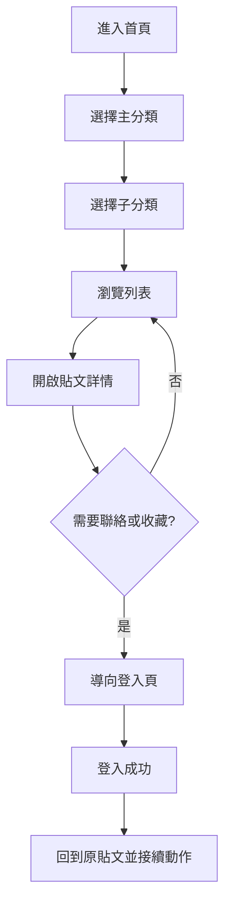
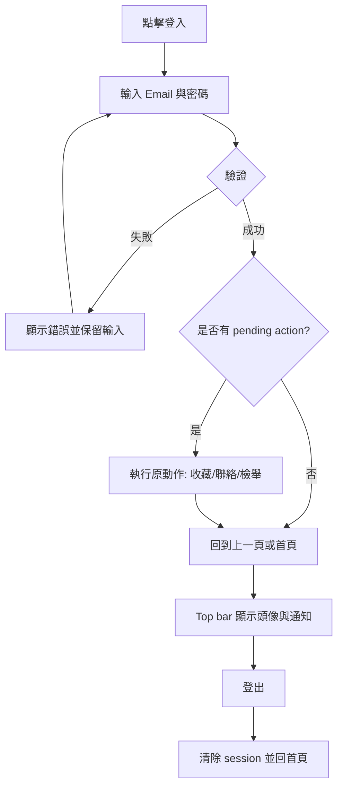
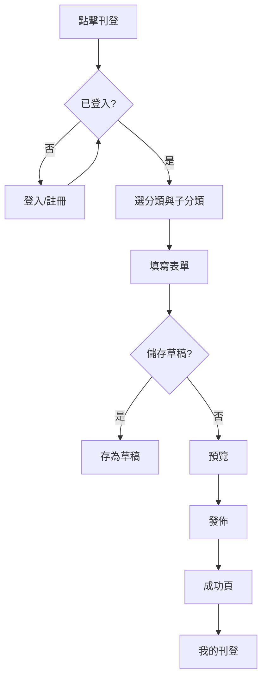

# Craigslist Taipei 介面改善：完整 AI 實作提示詞

> 本文件由 `Promot.md` 補齊而成。原始提示詞只有風格、分類與 Top bar 的描述，
> 缺少使用者流程、登入後功能、雙語翻譯、頁面規格、資料模型與驗收標準。
> 以下內容即為可直接交給 AI 或開發者執行的完整規格。

---

## 0. 給 AI 的任務指令

你是一位資深前端／全端工程師與 UI 設計師。請依照本文件，將目標網站
`https://www.craigslist.org/area/taipei` 重新設計為一個**精簡、明亮／黑暗雙主題、
中英雙語**的分類資訊網站。

實作時必須：

1. 嚴格遵守本文件的資訊架構、頁面規格、翻譯對照表與驗收標準。
2. 所有可見文字都必須走 i18n 字典，不得寫死單一語言。
3. 所有顏色、間距、圓角都必須使用設計 Token，不得臨時硬編碼。
4. 先完成 MVP（主頁、分類頁、列表頁、詳情頁、登入、主題與語言切換），
   再做登入後進階功能。
5. 不確定需求時，以「精簡、可預期、可存取」為優先，不要自行增加複雜功能。

---

## 1. 專案概述

### 1.1 目標

- 保留 Craigslist 的「分類資訊」本質，改善原本過於陽春、難以掃讀的介面。
- 讓使用者在 3 次點擊內從首頁到達任何一個子分類列表。
- 提供明亮與黑暗兩種一致的主題。
- 提供英文（en）與繁體中文（zh-TW）雙語介面，預設 zh-TW。
- 地點設定為台北，幣別 TWD，時區 Asia/Taipei，距離單位公里。

### 1.2 非目標

- 不做金流、物流、競標或平台代收款。
- 不做即時聊天（站內私訊以非同步訊息為限）。
- 不重製 Craigslist 的完整後台或演算法。
- 不直接使用 Craigslist 商標圖檔；練習專案請使用自製文字 Logo
  （例如「CL Taipei」）或佔位圖，取得授權後才可替換。

### 1.3 既有技術環境（依目前 repo）

- Python、Streamlit、psycopg、PostgreSQL（`announcements_announcement` 資料表已存在）。
- requirements 內亦有 Django，可作為登入／會員／REST API 的後端。
- 建議：Streamlit 負責畫面；Django 提供 `/api/*` 與 session/JWT；Postgres 儲存資料。
- 若只做前端 Prototype，可用假資料（mock data）並以 `st.session_state` 保存狀態，
  但**不得**在前端明文儲存密碼。

---

## 2. 設計原則與設計 Token

### 2.1 原則

| 原則 | 說明 |
| --- | --- |
| 精簡 | 一頁只保留主要任務；裝飾元素不超過畫面 10%。 |
| 一致 | 按鈕、卡片、表單、空狀態在 8 個分類頁完全一致。 |
| 可掃讀 | 列表以標題、價格、地點、時間四要素為主，其餘次要。 |
| 可預期 | 所有會導頁的按鈕外觀一致；破壞性操作需二次確認。 |
| 可存取 | 鍵盤可操作、對比度符合 WCAG AA、圖示按鈕有 aria-label。 |
| 不干擾 | 無自動輪播、無彈窗廣告、無聲音自動播放。 |

### 2.2 顏色 Token

| Token | Light | Dark | 用途 |
| --- | --- | --- | --- |
| `--bg` | `#FFFFFF` | `#0F1117` | 頁面背景 |
| `--surface` | `#F7F8FA` | `#161A23` | 卡片、表單區塊 |
| `--surface-elevated` | `#FFFFFF` | `#1C2230` | 下拉選單、Modal |
| `--text` | `#111827` | `#E8ECF4` | 主要文字 |
| `--text-muted` | `#6B7280` | `#9AA4B8` | 次要文字、時間 |
| `--border` | `#E5E7EB` | `#2B3240` | 邊框、分隔線 |
| `--primary` | `#2563EB` | `#6C8CFF` | 主要按鈕、連結 |
| `--primary-hover` | `#1D4ED8` | `#8AA3FF` | Hover |
| `--accent` | `#0F766E` | `#2DD4BF` | 標籤、強調 |
| `--success` | `#16A34A` | `#34D399` | 成功訊息 |
| `--warning` | `#D97706` | `#FBBF24` | 警告 |
| `--danger` | `#DC2626` | `#F87171` | 錯誤、刪除 |

規則：

- 文字與背景對比至少 4.5:1；大字至少 3:1。
- 不得只用顏色表達狀態，必須同時有文字或圖示。
- 主題切換需即時生效並持久化（localStorage 或使用者設定），且避免載入閃爍。

### 2.3 字體與排版

- 字體：`"Inter", "Noto Sans TC", system-ui, sans-serif`。
- 字級：12 / 14 / 16 / 20 / 24 / 32 px；行高 1.5。
- 標題字重 600，內文字重 400；不使用全大寫長句。
- 中英混排時，英文與數字使用 Inter，中文使用 Noto Sans TC。

### 2.4 間距、圓角、動態

- 間距：4 / 8 / 12 / 16 / 24 / 32 / 48 px。
- 圓角：按鈕 10px、卡片 14px、Modal 16px。
- 陰影：僅卡片 hover 與 Modal 使用，`0 8px 24px rgba(0,0,0,.12)`。
- 動態：150ms ease；尊重 `prefers-reduced-motion`。

### 2.5 響應式斷點

| 寬度 | 欄位數 | 說明 |
| --- | --- | --- |
| < 640px | 1 | 手機；Top bar 收合為選單 |
| 640–1024px | 2 | 平板 |
| > 1024px | 3–4 | 桌機；內容最大寬度 1200px |

---

## 3. 資訊架構

### 3.1 網站地圖

```text
/                         首頁（分類按鈕 + Top bar）
/c/{category}             分類頁（該分類的子分類按鈕）
/c/{category}/{sub}       子分類列表頁
/l/{listing_id}           貼文詳情頁
/search?q=                搜尋結果頁
/post/new                 刊登貼文頁（需登入）
/login                    登入頁
/register                 註冊頁
/forgot-password          忘記密碼頁
/me                       個人中心
/me/favorites             我的收藏
/me/listings              我的刊登
/me/messages              站內訊息
/me/notifications         通知
/me/settings              帳號與偏好設定
/about                    關於本站
/terms                    服務條款
/privacy                  隱私政策
```

### 3.2 八個主分類（首頁按鈕）

| slug | 英文 | 繁體中文 |
| --- | --- | --- |
| `community` | community | 社群 |
| `housing` | housing | 住居 |
| `services` | services | 服務 |
| `autos` | autos | 汽機車 |
| `discussion-forums` | discussion forums | 討論區 |
| `for-sale` | for sale | 出售 |
| `jobs` | jobs | 工作 |
| `gigs` | gigs | 接案 |

首頁只放這 8 個大型分類按鈕（卡片式，含圖示、英文名、中文名），
不得在首頁塞入所有子分類。

### 3.3 子分類

完整子分類清單見「附錄 A」。實作時以資料表 `categories`
（`slug`, `name_en`, `name_zh`, `parent_slug`, `sort_order`, `icon`）驅動，
不得在程式碼中複製貼上八份硬編碼清單。

---

## 4. 全域元件

### 4.1 Top bar（全站固定）

| 區域 | 內容 |
| --- | --- |
| 左 | Logo（點擊回首頁）、站名「CL Taipei」 |
| 中 | 搜尋框（桌機顯示；手機收合為圖示） |
| 右 | 主題切換、語言切換（EN／中文）、登入／註冊按鈕 |

登入後右側改為：

- 「刊登」主要按鈕
- 通知鈴鐺（未讀數量）
- 訊息圖示（未讀數量）
- 頭像下拉選單：我的帳號、我的收藏、我的刊登、設定、登出

規則：

- 固定高度 56px，背景使用 `--surface`，底部 1px `--border`。
- 捲動時不隱藏；手機版漢堡選單展開後可關閉（Esc 亦可）。
- Logo 替代文字為「CL Taipei 首頁」。
- 主題與語言切換需有 `aria-label`，並立即更新 `<html lang>` 與 `data-theme`。

### 4.2 分類按鈕卡片

- 內容：圖示、英文名、中文名、（可選）子分類數量。
- 尺寸：桌機 4 欄、平板 2 欄、手機 1 欄。
- 整張卡片可點擊；hover 提升 1px 並加深邊框；focus 顯示明顯外框。
- 點擊導向 `/c/{category}`。

### 4.3 貼文卡片（列表用）

- 左側：縮圖（無圖時顯示分類圖示佔位）。
- 主要：標題（最多 2 行）、價格（或「面議」）、地點、發佈時間。
- 右上：收藏按鈕（未登入點擊時跳出登入提示）。
- 整張卡片可點擊進入詳情；收藏按鈕需 `stopPropagation`。
- 已售出／已過期貼文降低透明度並顯示狀態標籤。

### 4.4 其他共用元件

| 元件 | 規格 |
| --- | --- |
| 按鈕 | 主要（實心 primary）、次要（外框）、文字（僅連結）、危險（danger） |
| 輸入框 | 標籤在上、錯誤訊息在下、必填以文字「必填」標示 |
| 下拉選單 | 支援鍵盤上下鍵與 Esc 關閉 |
| Modal | 點背景或 Esc 關閉；焦點鎖定在 Modal 內 |
| Toast | 右上角，3 秒自動消失，同時以 aria-live 播報 |
| 空狀態 | 圖示 + 標題 + 說明 + 主要動作按鈕 |
| 載入中 | 骨架卡片，不使用全頁轉圈超過 1 秒 |
| 錯誤狀態 | 顯示「發生錯誤」與「重試」按鈕，不顯示技術堆疊 |

---

## 5. 頁面規格

### 5.1 首頁 `/`

1. Top bar。
2. 標題區：主標「在台北找到你需要的」／副標說明。
3. 搜尋框（可選，與 Top bar 搜尋同步）。
4. 8 個分類按鈕卡片。
5. 最新公告（沿用既有 `announcements_announcement`，最多 3 筆；
   無資料顯示「目前沒有公告」）。
6. Footer：關於、條款、隱私、語言。

### 5.2 分類頁 `/c/{category}`

- 麵包屑：首頁 / 分類名。
- 標題：分類中英文名稱。
- 子分類按鈕清單（`discussion forums` 例外，見下）。
- 「查看全部」按鈕導向該分類全部貼文列表。
- 右側或下方可放該分類的熱門篩選（如價格區間），MVP 可省略。

`discussion forums` 子分類規則：不以子分類按鈕呈現，改為討論主題列表
（例如：一般討論、租屋經驗、交通、生活資訊），點擊後進入列表頁。

### 5.3 子分類列表頁 `/c/{category}/{sub}`

- 麵包屑：首頁 / 分類 / 子分類。
- 標題、結果數量（例：共 128 筆）。
- 篩選列：
  - 關鍵字搜尋
  - 價格區間（最低／最高）
  - 地區（台北市行政區）
  - 排序：最新、價格低到高、價格高到低、距離最近
  - 清除篩選
- 列表：貼文卡片，每頁 20 筆，「載入更多」或分頁。
- 空狀態：「找不到符合條件的貼文」＋「清除篩選」。
- 篩選條件需反映在 URL query string，重新整理後保留。

### 5.4 貼文詳情頁 `/l/{id}`

- 麵包屑。
- 標題、價格、地點、發佈時間、更新時間、瀏覽次數。
- 圖片輪播（最多 8 張，鍵盤可切換；無圖顯示佔位）。
- 描述（保留換行，禁止 HTML 注入）。
- 賣家資訊：顯示名稱、加入時間、其他刊登連結。
- 操作：收藏、聯絡賣家（站內私訊）、分享（複製連結）、檢舉。
- 未登入時收藏／聯絡／檢舉皆導向登入頁，登入後自動接續原動作。
- 自己的貼文顯示：編輯、標記售出、刪除（需二次確認）。

### 5.5 搜尋結果頁 `/search?q=`

- 顯示關鍵字、結果數量。
- 可依分類與地區二次篩選。
- 無結果時提供建議：檢查拼字、減少關鍵字、瀏覽分類。
- 搜尋字串需 trim、最長 100 字、防止 XSS。

### 5.6 刊登頁 `/post/new`

表單欄位：

| 欄位 | 必填 | 規則 |
| --- | --- | --- |
| 分類 | 是 | 先選主分類，再選子分類 |
| 標題 | 是 | 4–80 字 |
| 描述 | 是 | 10–4000 字 |
| 價格 | 否 | 0–9,999,999；可勾選「面議」 |
| 地點 | 是 | 台北市行政區 |
| 圖片 | 否 | 最多 8 張，每張 ≤ 5MB，jpg/png/webp |
| 聯絡方式 | 是 | 站內私訊（預設）；可選顯示 Email |
| 同意條款 | 是 | 未勾選不可送出 |

流程：填寫 → 預覽 → 發佈 → 成功頁（前往我的刊登／再刊登一筆）。
支援「儲存草稿」；離開頁面若有未儲存內容需提示。

### 5.7 登入／註冊

登入頁：

- Email、密碼、記住我、忘記密碼。
- 第三方登入（Google）為選配，MVP 可省略。
- 錯誤訊息不明確指出哪個欄位錯（避免帳號列舉），例如「Email 或密碼不正確」。

註冊頁：

- 顯示名稱、Email、密碼（至少 8 碼）、確認密碼、同意條款。
- 送出後寄送驗證信；未驗證帳號限制刊登與私訊。

密碼規則：至少 8 碼，包含字母與數字；伺服器端以 Argon2/bcrypt 雜湊，
不得明文或可逆加密儲存。

### 5.8 個人中心 `/me`

分頁：我的收藏、我的刊登、訊息、通知、設定。

- 我的收藏：貼文卡片，可移除收藏；被刪除的貼文顯示「已下架」。
- 我的刊登：狀態篩選（草稿／刊登中／已售出／已過期）、編輯、標記售出、刪除。
- 訊息：對話列表 + 對話內容；未讀以圓點標示；支援輸入與送出。
- 通知：收藏降價、收到私訊、貼文即將過期、系統公告。
- 設定：顯示名稱、頭像、語言、主題、Email 通知開關、修改密碼、刪除帳號。

---

## 6. 使用者流程

### 6.1 訪客瀏覽



### 6.2 登入／登出



規則：

- 登入成功後必須回到觸發登入的頁面，不可一律回首頁。
- Session 過期時，操作失敗需提示「請重新登入」，並保留表單內容。
- 登出需清除伺服器 session 與前端暫存（主題與語言偏好可保留）。

### 6.3 刊登貼文



### 6.4 收藏與取消收藏

- 未登入點收藏 → 登入頁 → 登入後自動完成收藏 → Toast「已加入收藏」。
- 已收藏點擊 → 立即取消 → Toast「已移除收藏」，支援復原（5 秒）。

### 6.5 私訊賣家

1. 於詳情頁點「聯絡賣家」。
2. 未登入先登入；不可私訊自己。
3. 輸入訊息（1–1000 字）→ 送出。
4. 對話建立或附加至既有對話；對方收到通知。
5. 訊息列表按最後更新時間排序。

### 6.6 檢舉

1. 點「檢舉」→ 選擇原因（詐騙、垃圾訊息、不當內容、錯誤分類、其他）。
2. 補充說明（選填，最多 500 字）。
3. 送出後顯示「已收到檢舉」；同一使用者對同一貼文 24 小時內僅能檢舉一次。
4. 檢舉進入後台佇列，管理員可下架貼文。

### 6.7 主題與語言切換

- 主題：跟隨系統 → 明亮 → 黑暗，三態循環或明確選單。
- 語言：EN / 中文；切換後整頁文字、日期格式、貨幣格式同步更新。
- 偏好儲存於 localStorage；登入者同步至帳號設定。
- 首次載入以系統主題與瀏覽器語言為預設，避免閃爍。

---

## 7. 登入後的特殊功能

| 功能 | 訪客 | 已登入 | 說明 |
| --- | --- | --- | --- |
| 瀏覽分類與貼文 | 可 | 可 | 基本功能 |
| 搜尋與篩選 | 可 | 可 | 條件存 URL |
| 收藏 | 不可（導登入） | 可 | 收藏清單於個人中心 |
| 聯絡賣家／私訊 | 不可 | 可 | 不可私訊自己 |
| 刊登貼文 | 不可 | 可 | 需驗證 Email |
| 儲存草稿 | 不可 | 可 | 草稿不公開 |
| 編輯／刪除自己的貼文 | 不可 | 可 | 刪除需確認 |
| 標記售出 | 不可 | 可 | 僅貼文擁有者 |
| 通知中心 | 不可 | 可 | 未讀數量顯示於 Top bar |
| 儲存搜尋條件 | 不可 | 可 | 有新貼文時通知 |
| 瀏覽歷史 | 本機暫存（選配） | 雲端同步 | 可清除 |
| 檢舉 | 不可 | 可 | 有頻率限制 |
| 主題／語言偏好 | 本機 | 帳號同步 | 跨裝置一致 |
| 帳號安全 | — | 可 | 修改密碼、登出所有裝置、刪除帳號 |

登入後才可用的功能，一律以「導向登入並保留原動作」處理，不可只顯示禁用按鈕。

---

## 8. 權限、驗證與邊界情況

### 8.1 驗證

- 前端即時驗證 + 後端再次驗證；後端為唯一可信來源。
- 所有輸入需 trim、長度限制、型別檢查與輸出轉義。
- 圖片檢查 MIME 與實際檔頭，重新編碼後儲存，避免偽裝檔。
- 上傳檔案使用隨機檔名，不可直接使用使用者檔名。

### 8.2 邊界情況

| 情境 | 處理 |
| --- | --- |
| 未登入執行受限動作 | 導向登入，登入後自動接續 |
| Session 過期 | 提示重新登入，保留表單內容 |
| 重複送出表單 | 送出後按鈕停用並顯示 loading |
| 貼文已刪除／過期 | 顯示「此貼文已下架」與返回列表 |
| 無權限編輯他人貼文 | 403 頁面，不洩漏資料 |
| 找不到頁面 | 404 頁面，提供回首頁與搜尋 |
| 伺服器錯誤 | 500 頁面，提供重試，不顯示堆疊 |
| 圖片過大／格式錯誤 | 欄位錯誤訊息，不阻擋其他欄位填寫 |
| 網路斷線 | 顯示離線提示，恢復後可重試 |
| 內容含 HTML／Script | 一律轉義，禁止 `innerHTML` 直接插入 |

### 8.3 安全

- 密碼雜湊（Argon2id 或 bcrypt），禁止明文。
- 登入與註冊需 rate limit（例如每 IP 每分鐘 5 次）。
- CSRF 防護、SameSite Cookie、HTTPS。
- 私訊與檢舉內容需長度限制與後台審核機制。
- 日誌不得記錄密碼、Token 或完整個資。

---

## 9. 資料模型（建議）

```text
users(id, email, password_hash, display_name, avatar_url, locale,
      theme, email_verified_at, created_at, updated_at, deleted_at)

categories(id, slug, name_en, name_zh, parent_slug, icon, sort_order)

listings(id, user_id, category_slug, subcategory_slug, title, description,
         price_cents, is_negotiable, district, status, view_count,
         created_at, updated_at, expires_at, sold_at)

listing_images(id, listing_id, url, sort_order, created_at)

favorites(id, user_id, listing_id, created_at, UNIQUE(user_id, listing_id))

conversations(id, listing_id, buyer_id, seller_id, created_at, updated_at)

messages(id, conversation_id, sender_id, body, read_at, created_at)

notifications(id, user_id, type, payload_json, read_at, created_at)

reports(id, reporter_id, listing_id, reason, note, status, created_at,
        handled_at, handled_by)

saved_searches(id, user_id, query, category_slug, filters_json,
               notify, created_at)

announcements_announcement(id, title, content, created_at)  -- 既有資料表
```

狀態值：`listing.status ∈ {draft, active, sold, expired, removed}`；
`report.status ∈ {open, reviewing, resolved, dismissed}`。

索引建議：`listings(category_slug, subcategory_slug, created_at)`、
`listings(status, expires_at)`、`messages(conversation_id, created_at)`、
`favorites(user_id, created_at)`。

---

## 10. 翻譯對照表（i18n）

### 10.1 規則

- 預設語言 `zh-TW`，可切換 `en`。
- 所有字串以 key 管理，例如 `nav.home`、`category.housing`、`error.required`。
- 翻譯檔結構：

```json
{
  "zh-TW": {
    "nav": { "home": "首頁", "login": "登入", "register": "註冊" },
    "common": { "search": "搜尋", "cancel": "取消", "save": "儲存" }
  },
  "en": {
    "nav": { "home": "Home", "login": "Log in", "register": "Sign up" },
    "common": { "search": "Search", "cancel": "Cancel", "save": "Save" }
  }
}
```

- 缺少翻譯時回退到 `zh-TW`，並在開發環境顯示警示，不可顯示 key 名稱。
- 日期：`2026/10/29`（zh-TW）、`Oct 29, 2026`（en）。
- 價格：`NT$1,200`；面議為「面議 / Negotiable」。

### 10.2 導覽與通用字串

| key | English | 繁體中文 |
| --- | --- | --- |
| `nav.home` | Home | 首頁 |
| `nav.search` | Search | 搜尋 |
| `nav.login` | Log in | 登入 |
| `nav.register` | Sign up | 註冊 |
| `nav.logout` | Log out | 登出 |
| `nav.post` | Post | 刊登 |
| `nav.favorites` | Favorites | 收藏 |
| `nav.myListings` | My listings | 我的刊登 |
| `nav.messages` | Messages | 訊息 |
| `nav.notifications` | Notifications | 通知 |
| `nav.settings` | Settings | 設定 |
| `nav.account` | My account | 我的帳號 |
| `common.searchPlaceholder` | Search listings | 搜尋貼文 |
| `common.all` | All | 全部 |
| `common.viewAll` | View all | 查看全部 |
| `common.loadMore` | Load more | 載入更多 |
| `common.previous` | Previous | 上一頁 |
| `common.next` | Next | 下一頁 |
| `common.save` | Save | 儲存 |
| `common.cancel` | Cancel | 取消 |
| `common.delete` | Delete | 刪除 |
| `common.edit` | Edit | 編輯 |
| `common.preview` | Preview | 預覽 |
| `common.publish` | Publish | 發佈 |
| `common.retry` | Retry | 重試 |
| `common.clearFilters` | Clear filters | 清除篩選 |
| `common.results` | {count} results | 共 {count} 筆 |
| `common.required` | Required | 必填 |
| `common.optional` | Optional | 選填 |
| `common.negotiable` | Negotiable | 面議 |
| `common.free` | Free | 免費 |
| `common.sold` | Sold | 已售出 |
| `common.expired` | Expired | 已過期 |
| `common.removed` | Removed | 已下架 |
| `common.share` | Share | 分享 |
| `common.report` | Report | 檢舉 |
| `common.confirm` | Confirm | 確認 |
| `common.back` | Back | 返回 |

### 10.3 篩選與排序

| key | English | 繁體中文 |
| --- | --- | --- |
| `filter.keyword` | Keyword | 關鍵字 |
| `filter.price` | Price | 價格 |
| `filter.minPrice` | Min price | 最低價格 |
| `filter.maxPrice` | Max price | 最高價格 |
| `filter.district` | District | 地區 |
| `filter.sort` | Sort by | 排序 |
| `sort.newest` | Newest | 最新 |
| `sort.priceAsc` | Price: low to high | 價格低到高 |
| `sort.priceDesc` | Price: high to low | 價格高到低 |
| `sort.nearest` | Nearest | 距離最近 |

### 10.4 表單與帳號

| key | English | 繁體中文 |
| --- | --- | --- |
| `form.title` | Title | 標題 |
| `form.description` | Description | 描述 |
| `form.price` | Price | 價格 |
| `form.category` | Category | 分類 |
| `form.subcategory` | Subcategory | 子分類 |
| `form.location` | Location | 地點 |
| `form.images` | Photos | 圖片 |
| `form.imagesHint` | Up to 8 images, max 5MB each | 最多 8 張，每張 5MB |
| `form.contact` | Contact method | 聯絡方式 |
| `form.agreeTerms` | I agree to the Terms of Service | 我同意服務條款 |
| `form.saveDraft` | Save as draft | 儲存草稿 |
| `auth.email` | Email | 電子郵件 |
| `auth.password` | Password | 密碼 |
| `auth.confirmPassword` | Confirm password | 確認密碼 |
| `auth.displayName` | Display name | 顯示名稱 |
| `auth.rememberMe` | Remember me | 記住我 |
| `auth.forgotPassword` | Forgot password? | 忘記密碼？ |
| `auth.noAccount` | Don't have an account? | 還沒有帳號？ |
| `auth.hasAccount` | Already have an account? | 已有帳號？ |

### 10.5 訊息、空狀態與錯誤

| key | English | 繁體中文 |
| --- | --- | --- |
| `empty.noResults` | No listings found | 找不到符合條件的貼文 |
| `empty.noResultsHint` | Try different keywords or filters | 調整關鍵字或篩選條件後再試 |
| `empty.noAnnouncements` | No announcements yet | 目前沒有公告 |
| `empty.noFavorites` | You haven't saved anything yet | 您還沒有收藏任何貼文 |
| `empty.noMessages` | No messages yet | 目前沒有訊息 |
| `empty.noNotifications` | No notifications | 目前沒有通知 |
| `state.loading` | Loading... | 載入中... |
| `state.loginRequired` | Please log in to continue | 請先登入以繼續 |
| `state.loginToFavorite` | Log in to save this listing | 登入後即可收藏 |
| `state.loginToContact` | Log in to contact the seller | 登入後即可聯絡賣家 |
| `toast.favorited` | Added to favorites | 已加入收藏 |
| `toast.unfavorited` | Removed from favorites | 已移除收藏 |
| `toast.published` | Your listing is live | 貼文已發佈 |
| `toast.saved` | Changes saved | 已儲存變更 |
| `toast.reported` | Report received | 已收到檢舉 |
| `toast.copied` | Link copied | 已複製連結 |
| `error.required` | This field is required | 此欄位為必填 |
| `error.invalidEmail` | Enter a valid email address | 請輸入有效的電子郵件 |
| `error.passwordLength` | Password must be at least 8 characters | 密碼至少需 8 碼 |
| `error.passwordMismatch` | Passwords do not match | 兩次輸入的密碼不一致 |
| `error.loginFailed` | Incorrect email or password | Email 或密碼不正確 |
| `error.fileTooLarge` | File exceeds 5MB | 檔案超過 5MB |
| `error.generic` | Something went wrong. Please retry. | 發生錯誤，請重試 |
| `error.notFound` | Page not found | 找不到頁面 |
| `error.forbidden` | You don't have permission to view this | 您沒有權限檢視此內容 |
| `confirm.delete` | Delete this listing permanently? | 確定要永久刪除此貼文？ |
| `confirm.logout` | Log out of this device? | 確定要登出此裝置？ |

### 10.6 主分類翻譯

| key | English | 繁體中文 |
| --- | --- | --- |
| `category.community` | Community | 社群 |
| `category.housing` | Housing | 住居 |
| `category.services` | Services | 服務 |
| `category.autos` | Autos | 汽機車 |
| `category.discussionForums` | Discussion forums | 討論區 |
| `category.forSale` | For sale | 出售 |
| `category.jobs` | Jobs | 工作 |
| `category.gigs` | Gigs | 接案 |

---

## 11. 無障礙與國際化

- 每頁只有一個 `<h1>`，標題層級不可跳階。
- 所有圖片有 `alt`；裝飾圖 `alt=""`。
- 表單元素必須有 `<label>`，不可只用 placeholder。
- 焦點樣式清楚可見（2px primary 外框），不得 `outline: none` 後無替代。
- 顏色不是唯一資訊來源；已售出需有文字標籤。
- 觸控目標至少 44×44px。
- 支援鍵盤完成：分類導覽、搜尋、收藏、送出表單、關閉 Modal。
- Modal 開啟時焦點鎖定，關閉後回到觸發元素。
- 動態內容（Toast、通知數量）使用 `aria-live="polite"`。
- `<html lang>` 隨語言切換為 `zh-Hant-TW` 或 `en`。
- 不以圖片文字傳達必要資訊；所有文字可被翻譯與搜尋。

---

## 12. 效能

- 首頁首次載入目標 < 2 秒（一般 4G）。
- 列表頁圖片使用縮圖與 `loading="lazy"`，並設定寬高避免版面位移。
- 列表查詢必須分頁，禁止一次載入全部資料。
- 分類與翻譯字典可快取；主題切換不重新載入頁面。
- 圖片上傳前於前端壓縮（長邊 ≤ 1600px），後端仍須驗證。

---

## 13. 驗收標準

| ID | 驗收項目 |
| --- | --- |
| AC-01 | 首頁僅有 Top bar、8 個主分類按鈕、公告與 Footer，沒有其他無關區塊。 |
| AC-02 | 點擊任一主分類可進入分類頁，並看到該分類的子分類按鈕。 |
| AC-03 | 點擊子分類可進入列表頁，顯示貼文卡片與結果數量。 |
| AC-04 | 從首頁到任一子分類列表不超過 3 次點擊。 |
| AC-05 | Top bar 左側為 Logo、右側在未登入時顯示登入／註冊。 |
| AC-06 | 登入後 Top bar 顯示刊登按鈕、通知、訊息與頭像選單。 |
| AC-07 | 明亮與黑暗主題皆可切換，且重新整理後保持選擇。 |
| AC-08 | 中文與英文可切換，所有可見文字（含錯誤訊息）皆同步翻譯。 |
| AC-09 | 未登入點擊收藏／聯絡／檢舉會導向登入，登入後自動完成原動作。 |
| AC-10 | 使用者可刊登貼文、存草稿、編輯、標記售出與刪除自己的貼文。 |
| AC-11 | 使用者無法編輯或刪除他人貼文（403）。 |
| AC-12 | 列表篩選條件反映於 URL，重新整理後仍保留。 |
| AC-13 | 空狀態、載入中、錯誤狀態皆有對應畫面與可執行按鈕。 |
| AC-14 | 手機寬度 375px 下無水平捲動，主要操作仍可完成。 |
| AC-15 | 僅用鍵盤可完成登入、搜尋、開啟貼文與收藏。 |
| AC-16 | 所有表單皆有前後端驗證，密碼以雜湊儲存。 |
| AC-17 | 貼文與私訊內容輸出時已轉義，無法注入 HTML／Script。 |
| AC-18 | 公告區塊沿用現有資料表，無資料時顯示「目前沒有公告」。 |

---

## 14. 測試案例（最小集合）

1. 未登入首頁 → 分類 → 子分類 → 詳情 → 收藏 → 被導向登入 → 登入後收藏成功。
2. 切換黑暗模式 → 重新整理 → 仍為黑暗模式。
3. 切換英文 → 檢查首頁、分類頁、表單錯誤訊息皆為英文。
4. 刊登一筆無圖片貼文 → 成功頁 → 我的刊登可見 → 編輯 → 標記售出。
5. 另一帳號嘗試編輯該貼文 → 403。
6. 搜尋不存在的關鍵字 → 顯示空狀態與清除篩選。
7. 上傳 6MB 圖片 → 顯示檔案過大錯誤，其他欄位內容保留。
8. 手機 375px 操作完整流程，無水平捲動。
9. 僅用 Tab/Enter/Esc 完成登入與開啟 Modal。
10. 對同一貼文連續檢舉兩次 → 第二次被頻率限制阻擋。

---

## 15. 實作順序（里程碑）

| 階段 | 內容 |
| --- | --- |
| M1 設計基礎 | 設計 Token、明暗主題、i18n 字典、Top bar、Footer |
| M2 瀏覽核心 | 首頁、分類頁、列表頁、詳情頁、搜尋與篩選（mock data） |
| M3 帳號 | 註冊、登入、登出、session、權限控制 |
| M4 刊登 | 刊登表單、草稿、圖片上傳、我的刊登、標記售出 |
| M5 互動 | 收藏、私訊、通知、檢舉 |
| M6 收尾 | 無障礙、效能、錯誤頁、測試與驗收 |

每個階段完成後需執行：

- 明暗主題截圖檢查。
- 中英文文字檢查（無漏翻、無 hardcode）。
- 手機／平板／桌機三種寬度檢查。
- 上述驗收標準對照。

---

## 附錄 A：子分類完整清單（英／中）

### community 社群

| slug | English | 繁體中文 |
| --- | --- | --- |
| `activities` | activities | 活動 |
| `artists` | artists | 藝術家 |
| `childcare` | childcare | 托育 |
| `general` | general | 綜合 |
| `groups` | groups | 社團 |
| `local-news` | local news | 地方新聞 |
| `lost-found` | lost+found | 失物招領 |
| `missed-connections` | missed connections | 尋人啟事 |
| `musicians` | musicians | 樂手 |
| `pets` | pets | 寵物 |
| `politics` | politics | 政治 |
| `rants-raves` | rant+raves | 抱怨與讚美 |
| `rideshare` | rideshare | 共乘 |
| `volunteers` | volunteers | 志工 |

### housing 住居

| slug | English | 繁體中文 |
| --- | --- | --- |
| `apts-housing` | apartments / housing for rent | 公寓出租 |
| `housing-swap` | housing swap | 住宅交換 |
| `housing-wanted` | housing wanted | 徵屋 |
| `office-commercial` | office / commercial | 商用空間 |
| `parking-storage` | parking + storage | 車位／倉儲 |
| `real-estate-sale` | real estate for sale | 房地產出售 |
| `rooms-shared` | rooms / shared | 分租雅房 |
| `sublets-temporary` | sublets / temporary | 短期轉租 |
| `vacation-rentals` | vacation rentals | 度假短租 |

### services 服務

| slug | English | 繁體中文 |
| --- | --- | --- |
| `automotive` | automotive | 汽車服務 |
| `beauty` | beauty | 美容 |
| `cell-mobile` | cell / mobile | 手機 |
| `computer` | computer | 電腦 |
| `creative` | creative | 創意設計 |
| `cycle` | cycle | 自行車 |
| `event` | event | 活動 |
| `farm-garden` | farm + garden | 農園藝 |
| `financial` | financial | 財務 |
| `health-wellness` | health / wellness | 健康 |
| `household` | household | 家事 |
| `labor-move` | labor / move | 搬運 |
| `legal` | legal | 法律 |
| `lessons` | lessons | 家教 |
| `marine` | marine | 船舶 |
| `pet` | pet | 寵物 |
| `real-estate` | real estate | 房地產 |
| `skilled-trade` | skilled trade | 專業技工 |
| `smb-advertising` | small business ads | 小型商家廣告 |
| `tax` | tax | 稅務 |
| `tech` | tech | 科技 |
| `travel-vacation` | travel / vacation | 旅遊 |
| `writing-editing` | writing / editing | 寫作編輯 |

### autos 汽機車

| slug | English | 繁體中文 |
| --- | --- | --- |
| `cars-trucks` | cars + trucks | 轎車／貨車 |
| `motorcycles-scooters` | motorcycles / scooters | 機車／速克達 |
| `rvs` | RVs | 露營車 |
| `trailers` | trailers | 拖車 |
| `auto-parts` | auto parts | 汽車零件 |
| `wheels-tires` | auto wheels & tires | 輪胎／輪框 |
| `aviation` | aviation | 航空 |
| `boats` | boats | 船隻 |
| `boat-parts` | boat parts | 船用零件 |
| `bikes` | bikes | 自行車 |
| `commercial-trucks` | commercial trucks | 商用卡車 |
| `heavy-equipment` | heavy equipment | 重型機具 |

### discussion forums 討論區

無子分類；以主題列表呈現：

| slug | English | 繁體中文 |
| --- | --- | --- |
| `general` | general discussion | 一般討論 |
| `housing` | housing | 租屋經驗 |
| `transport` | transport | 交通 |
| `living` | living in Taipei | 台北生活 |
| `buy-sell` | buy & sell | 買賣交流 |

### for sale 出售

| slug | English | 繁體中文 |
| --- | --- | --- |
| `antiques` | antiques | 古董 |
| `appliances` | appliances | 家電 |
| `arts-crafts` | arts + crafts | 工藝 |
| `atv-utv-snow` | ATV / UTV / snow | 越野車 |
| `auto-parts` | auto parts | 汽車零件 |
| `baby-kids` | baby + kids | 嬰幼童 |
| `barter` | barter | 以物易物 |
| `beauty-health` | beauty + health | 美妝保健 |
| `bike-parts` | bike parts | 自行車零件 |
| `bikes` | bikes | 自行車 |
| `boat-parts` | boat parts | 船用零件 |
| `boats` | boats | 船隻 |
| `books` | books | 書籍 |
| `business` | business | 商業設備 |
| `cars-trucks` | cars + trucks | 轎車／貨車 |
| `cds-dvd-vhs` | CDs / DVDs / VHS | 影音 |
| `cell-phones` | cell phones | 手機 |
| `clothes-accessories` | clothes + accessories | 服飾配件 |
| `collectibles` | collectibles | 收藏品 |
| `computer-parts` | computer parts | 電腦零件 |
| `computers` | computers | 電腦 |
| `electronics` | electronics | 電子產品 |
| `farm-garden` | farm + garden | 農園藝 |
| `free` | free | 免費 |
| `furniture` | furniture | 家具 |
| `garage-sale` | garage sale | 車庫拍賣 |
| `general` | general | 綜合 |
| `heavy-equipment` | heavy equipment | 重型機具 |
| `household` | household | 居家用品 |
| `jewelry` | jewelry | 珠寶 |
| `materials` | materials | 建材 |
| `motorcycles` | motorcycles | 機車 |
| `music-instruments` | musical instruments | 樂器 |
| `photo-video` | photo + video | 攝影器材 |
| `rvs` | RVs | 露營車 |
| `sporting` | sporting goods | 運動用品 |
| `tickets` | tickets | 票券 |
| `tools` | tools | 工具 |
| `toys-games` | toys + games | 玩具 |
| `trailers` | trailers | 拖車 |
| `video-gaming` | video gaming | 電玩 |
| `wanted` | wanted | 徵求 |

### jobs 工作

| slug | English | 繁體中文 |
| --- | --- | --- |
| `accounting-finance` | accounting + finance | 會計財務 |
| `admin-office` | admin / office | 行政 |
| `arch-engineering` | arch / engineering | 建築工程 |
| `art-media-design` | art / media / design | 藝術媒體設計 |
| `business-management` | business / management | 商業管理 |
| `customer-service` | customer service | 客服 |
| `education` | education | 教育 |
| `energy` | energy | 能源 |
| `engineering` | engineering | 工程 |
| `food-beverage-hospitality` | food / beverage / hospitality | 餐飲旅宿 |
| `general-labor` | general labor | 一般勞動 |
| `government` | government | 政府 |
| `healthcare` | healthcare | 醫療 |
| `human-resources` | human resources | 人資 |
| `legal-paralegal` | legal / paralegal | 法律 |
| `manufacturing` | manufacturing | 製造 |
| `marketing-advertising` | marketing / advertising | 行銷廣告 |
| `nonprofit` | nonprofit | 非營利 |
| `real-estate` | real estate | 房地產 |
| `retail-wholesale` | retail / wholesale | 零售批發 |
| `sales` | sales | 業務 |
| `salon-spa-fitness` | salon / spa / fitness | 美髮健身 |
| `science-biotech` | science / biotech | 科學生技 |
| `security` | security | 保全 |
| `skilled-trade-artisan` | skilled trade / artisan | 技工 |
| `software-qa-dba` | software / QA / DBA | 軟體 |
| `systems-networking` | systems / networking | 系統網路 |
| `technical-support` | technical support | 技術支援 |
| `transport` | transport | 運輸 |
| `tv-film-video` | TV / film / video | 影視 |
| `web-design` | web / HTML / info design | 網頁設計 |
| `writing-editing` | writing / editing | 寫作編輯 |

### gigs 接案

| slug | English | 繁體中文 |
| --- | --- | --- |
| `computer-gigs` | computer gigs | 電腦接案 |
| `creative-gigs` | creative gigs | 創意接案 |
| `crew-gigs` | crew gigs | 團隊接案 |
| `domestic-gigs` | domestic gigs | 家事接案 |
| `event-gigs` | event gigs | 活動接案 |
| `labor-gigs` | labor gigs | 勞動接案 |
| `talent-gigs` | talent gigs | 才藝接案 |
| `writing-gigs` | writing gigs | 寫作接案 |

---

## 附錄 B：原始提示詞缺口對照

| 原始 `Promot.md` 內容 | 本文件補齊處 |
| --- | --- |
| 目標網站與精簡風格 | 第 2 章設計原則與 Token |
| 明亮／黑暗兩種介面 | 2.2 顏色 Token、6.7 主題切換、AC-07 |
| 分成更多頁數、八個分類 | 第 3 章資訊架構、附錄 A |
| 子分類按鈕 | 3.3、5.2、附錄 A |
| Top bar：左 Logo、右登入 | 4.1、AC-05、AC-06 |
| 使用者流程（原缺） | 第 6 章（含流程圖） |
| 登入後特殊功能（原缺） | 第 7 章 |
| 英文及中文翻譯（原缺） | 第 10 章、附錄 A |
| 頁面細節（原缺） | 第 5 章 |
| 資料與權限（原缺） | 第 8、9 章 |
| 完成標準（原缺） | 第 13、14 章 |
